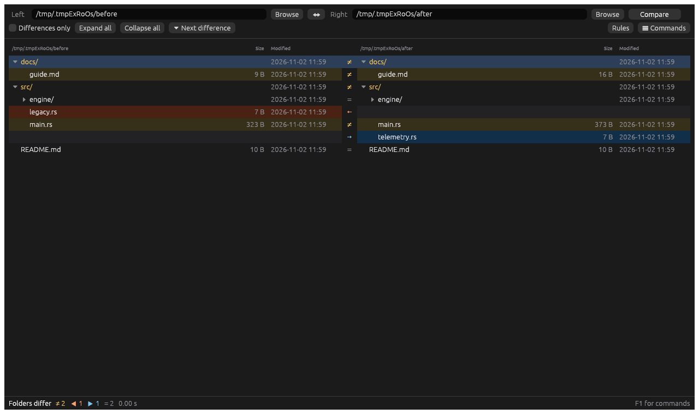
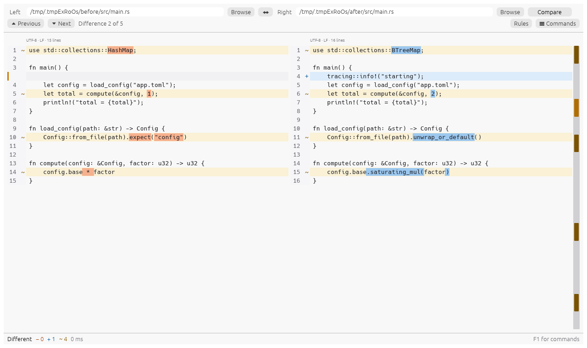

<p align="center"></p>

# difflux

[](https://github.com/meetdhruva/difflux/actions/workflows/ci.yml)
[](https://github.com/meetdhruva/difflux/releases/latest)
[](#license)

Fast, reliable file and folder compare. A native, cross-platform replacement
for Beyond Compare, written in Rust.

- **Folder compare** that scans both trees in parallel and tells you *why* each
  verdict was reached (bytes read, size differs, or size and time trusted).
- **Text compare** with a histogram diff, similarity-based line pairing and
  word-level highlights, virtualized so million-line files open instantly.
- **Terminal and agent friendly**: `difflux diff --json` emits a versioned
  schema, and `difflux mcp` lets AI agents compare files and folders.
- **Accessible**: screen-reader labels on every row, color-blind-safe
  palette with glyphs, full keyboard control, zoom with `Ctrl +`/`Ctrl −`.

Windows, macOS and Linux. MIT or Apache-2.0.




## Install

Download the archive for your platform from the
[latest release](https://github.com/meetdhruva/difflux/releases/latest):

| Platform | Download |
|---|---|
| Debian / Ubuntu (x64, Arm64) | `difflux_<version>-1_amd64.deb` / `_arm64.deb` (adds a menu entry) |
| Windows (x64, Arm64) | `difflux-<version>-windows-x86_64.zip` / `-windows-arm64.zip` |
| macOS app (Apple Silicon + Intel) | `difflux-<version>-macos-universal.app.zip` |
| macOS command line | `difflux-<version>-macos-universal.tar.gz` |
| Linux (x64, Arm64) | `difflux-<version>-linux-x86_64.tar.gz` / `-linux-arm64.tar.gz` |
| Linux, static CLI + MCP only (servers, CI, containers) | `difflux-<version>-linux-x86_64-cli-static.tar.gz` / `-linux-arm64-cli-static.tar.gz` |

Each archive contains `difflux` (command line; opens the app when run without a
subcommand) and, for desktop builds, `difflux-app` (opens the app without a
console window). Put them on your `PATH`. Linux archives also contain
`share/` with a desktop entry and icons; copy it to `~/.local/share` (or
`/usr/local/share`) to get a menu entry.

Builds are not code-signed yet. On macOS, right-click the app and choose
**Open** the first time; on Windows, choose **More info → Run anyway**.
Every download has a SHA-256 checksum and signed build provenance; see
[SECURITY.md](SECURITY.md#verifying-downloads).

From source: `cargo install --locked --git https://github.com/meetdhruva/difflux difflux`

## Use it

```sh
difflux                         # open the app
difflux old/ new/               # open the app comparing two folders
difflux diff a.txt b.txt        # unified diff in the terminal
difflux diff old/ new/ --json   # machine-readable report
difflux diff -q old/ new/       # just "differ" or nothing, like diff -q
difflux mcp                     # MCP server on stdio for AI agents
difflux schema                  # JSON Schema of --json output
```

Exit codes follow `diff(1)`: **0** no differences, **1** differences, **2** trouble.

### As a git difftool

```sh
git config --global difftool.difflux.cmd 'difflux "$LOCAL" "$REMOTE"'
git config --global diff.tool difflux
git difftool --dir-diff
```

### For AI agents (MCP)

Add to your MCP client configuration:

```json
{ "mcpServers": { "difflux": { "command": "difflux", "args": ["mcp"] } } }
```

Tools: `compare_paths` (files or folders on disk) and `compare_text` (two
strings). Both are read-only and return `difflux/1` JSON.

### Keyboard

| Action | Keys |
|---|---|
| Compare / refresh | `F5`, `Ctrl+Enter` |
| Next / previous difference | `F8` / `Shift+F8`, `Ctrl+N` / `Ctrl+P`, `Alt+↓` / `Alt+↑` |
| Open entry / back to folder | `Enter` / `Backspace`, `Alt+←` |
| Toggle ignore whitespace / case | `Alt+W` / `Alt+C` |
| Differences only | `Alt+D` |
| Swap sides | `Ctrl+Shift+X` |
| Copy as unified diff | `Ctrl+Shift+C` |
| Command palette | `Ctrl+Shift+P`, `F1` |
| All shortcuts | `Ctrl+/` |

## Build

Requires Rust 1.97+ (pinned in `rust-toolchain.toml`).

```sh
cargo run --release -- LEFT RIGHT                  # desktop app
cargo build --release -p difflux --no-default-features   # headless CLI + MCP only
cargo xtask ci                                     # fmt, clippy, tests, schema check
```

Linux needs the usual windowing libraries at runtime (X11 or Wayland, and a
Vulkan or GL driver).

## Design

See [`docs/adr`](docs/adr) for the decisions and [`AGENTS.md`](AGENTS.md) for
the crate map and contribution rules. In short:

```
GUI (egui)        CLI · JSON · MCP
        \            /
   difflux-app (jobs, view-models, commands)
                |
 diff-text · diff-dir   (engines, pure, parallel)
                |
     text · core   (decoding, types; no I/O)
```

## Roadmap

1. ~~Folder compare, text compare, CLI/JSON, MCP~~ (this release)
2. Editing and merging in the text view, with atomic saves and undo
3. Folder sync: preview → confirm → journaled execution → trash, never delete
4. 3-way merge (diff3) for `git mergetool`
5. Hex compare with rsync-style anchors; table (CSV) and image compare
6. Archives, SFTP and cloud storage through a virtual file system layer

## Contributing

Issues and pull requests are welcome: see [CONTRIBUTING.md](CONTRIBUTING.md)
and the [Code of Conduct](CODE_OF_CONDUCT.md). Report security issues
privately as described in [SECURITY.md](SECURITY.md). Changes are listed in
[CHANGELOG.md](CHANGELOG.md).

## License

Licensed under either of [Apache License 2.0](LICENSE-APACHE) or
[MIT license](LICENSE-MIT), at your option.

Unless you explicitly state otherwise, any contribution intentionally
submitted for inclusion in difflux by you, as defined in the Apache-2.0
license, shall be dual licensed as above, without any additional terms or
conditions.
